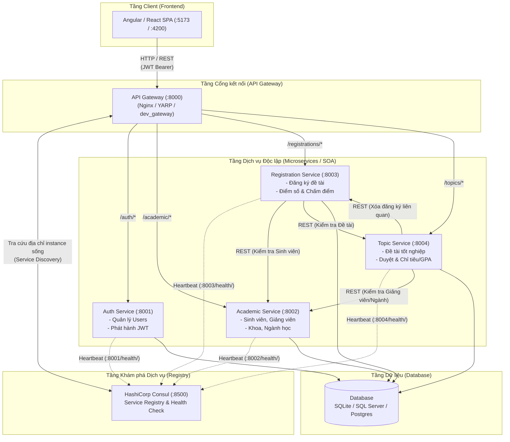

# TÀI LIỆU KỸ THUẬT HỆ THỐNG SOA (SERVICE-ORIENTED ARCHITECTURE)
> **Mục đích**: Tài liệu này đúc kết toàn bộ các nguyên lý kiến trúc, công nghệ, mẫu thiết kế (design patterns) và quy trình xử lý của dự án hiện tại, đồng thời cung cấp cẩm nang chi tiết và mã nguồn mẫu để bạn chuyển giao, tham chiếu và lập trình dự án mới với **Backend .NET (C#)** và **Frontend Angular**.

---

## MỤC LỤC
1. [Tổng quan Kiến trúc Hệ thống (SOA Architecture)](#1-tổng-quan-kiến-trúc-hệ-thống-soa-architecture)
2. [Kỹ thuật Backend & Cơ chế Dịch vụ](#2-kỹ-thuật-backend--cơ-chế-dịch-vụ)
   - [2.1. Phân rã dịch vụ & Ranh giới dữ liệu (Domain Boundaries)](#21-phân-rã-dịch-vụ--ranh-giới-dữ-liệu-domain-boundaries)
   - [2.2. Hợp đồng API & Chuẩn hóa DTO](#22-hợp-đồng-api--chuẩn-hóa-dto)
   - [2.3. Xác thực & Phân quyền Stateless qua JWT](#23-xác-thực--phân-quyền-stateless-qua-jwt)
   - [2.4. Giao tiếp liên dịch vụ (Service-to-Service Communication)](#24-giao-tiếp-liên-dịch-vụ-service-to-service-communication)
   - [2.5. Cơ chế CSDL nhúng SQLite & Database-First](#25-cơ-chế-csdl-nhúng-sqlite--database-first)
3. [Kỹ thuật API Gateway & Service Discovery](#3-kỹ-thuật-api-gateway--service-discovery)
   - [3.1. API Gateway (Reverse Proxy)](#31-api-gateway-reverse-proxy)
   - [3.2. Khám phá dịch vụ với HashiCorp Consul](#32-khám-phá-dịch-vụ-với-hashicorp-consul)
4. [Kỹ thuật Frontend (Single Page Application)](#4-kỹ-thuật-frontend-single-page-application)
   - [4.1. Kiến trúc luồng xác thực & Http Interceptor](#41-kiến-trúc-luồng-xác-thực--http-interceptor)
   - [4.2. Phân quyền giao diện & Route Guards](#42-phân-quyền-giao-diện--route-guards)
5. [Cẩm nang chuyển giao: Lập trình với .NET & Angular](#5-cẩm-nang-chuyển-giao-lập-trình-với-net--angular)
   - [5.1. Tổ chức Solution trong .NET](#51-tổ-chức-solution-trong-net)
   - [5.2. Xây dựng API Gateway với YARP](#52-xây-dựng-api-gateway-với-yarp)
   - [5.3. Tích hợp Consul Service Discovery trong ASP.NET Core](#53-tích-hợp-consul-service-discovery-trong-aspnet-core)
   - [5.4. Cấu hình JWT Bearer & Role Authorization trong .NET](#54-cấu-hình-jwt-bearer--role-authorization-trong-net)
   - [5.5. Giao tiếp liên dịch vụ với IHttpClientFactory + Polly](#55-giao-tiếp-liên-dịch-vụ-với-ihttpclientfactory--polly)
   - [5.6. Cấu hình Database với Entity Framework Core](#56-cấu-hình-database-với-entity-framework-core)
   - [5.7. Xây dựng Frontend với Angular (v17+)](#57-xây-dựng-frontend-với-angular-v17)
6. [Kinh nghiệm thực tiễn & Bẫy thường gặp (Pitfalls)](#6-kinh-nghiệm-thực-tiễn--bẫy-thường-gặp-pitfalls)

---

## 1. Tổng quan Kiến trúc Hệ thống (SOA Architecture)

Kiến trúc hướng dịch vụ (SOA) chia nhỏ ứng dụng lớn thành các dịch vụ độc lập, chuyên biệt cho từng nghiệp vụ kinh doanh. Các dịch vụ tương tác với nhau và với thế giới bên ngoài thông qua các giao thức mạng tiêu chuẩn (HTTP/REST) thay vì liên kết chặt chẽ (tight coupling) ở tầng code hay database.



### Nguyên tắc vàng của SOA trong dự án:
1. **Loose Coupling (Ràng buộc lỏng lẻo)**: Mỗi service là một project/tiến trình độc lập, sở hữu code riêng, port riêng. Không service nào được import code hoặc model ORM của service khác.
2. **High Cohesion (Gắn kết cao)**: Mỗi service chỉ chịu trách nhiệm duy nhất một nghiệp vụ domain (Auth quản lý tài khoản, Academic quản lý hồ sơ trường, Topic quản lý đề tài).
3. **API Contracts First**: Các service chỉ biết về nhau thông qua hợp đồng API công khai (REST endpoints, JSON DTOs).

---

## 2. Kỹ thuật Backend & Cơ chế Dịch vụ

### 2.1. Phân rã dịch vụ & Ranh giới dữ liệu (Domain Boundaries)
Mỗi service chỉ đọc/ghi trực tiếp vào **các bảng mà mình sở hữu**:
* `auth-service`: Sở hữu bảng `Users`.
* `academic-services`: Sở hữu `Students`, `Lecturers`, `Faculties`, `Majors`, `Specializations`.
* `regist-service`: Sở hữu `Registrations`.
* `topic-service`: Sở hữu `Topics`.

> [!IMPORTANT]
> **Quy tắc ranh giới dữ liệu**: Khi service A cần dữ liệu từ service B (ví dụ `regist-service` cần kiểm tra xem sinh viên có tồn tại và thuộc khoa hợp lệ không), service A **không bao giờ** JOIN trực tiếp vào bảng của service B, mà phải **gửi yêu cầu HTTP GET** sang endpoint của service B để kiểm tra.

### 2.2. Hợp đồng API & Chuẩn hóa DTO
* Không bao giờ serialize và trả trực tiếp đối tượng database model ra ngoài (để tránh rò rỉ các trường nhạy cảm như password hash, private flag).
* Luôn sử dụng **Data Transfer Object (DTO)** / Serializer:
  * Request DTO: Xác thực dữ liệu đầu vào (Validation).
  * Response DTO: Định dạng dữ liệu đầu ra chuẩn hóa (CamelCase hoặc snake_case thống nhất, kiểu thời gian ISO-8601).
* Mã trạng thái HTTP (Status Codes):
  * `200 OK`: Truy vấn hoặc cập nhật thành công.
  * `201 Created`: Tạo mới tài nguyên thành công.
  * `400 Bad Request`: Dữ liệu đầu vào sai định dạng / validation thất bại.
  * `401 Unauthorized`: Thiếu hoặc sai token xác thực.
  * `403 Forbidden`: Token hợp lệ nhưng không đủ quyền (sai Role).
  * `404 Not Found`: Không tìm thấy tài nguyên.
  * `409 Conflict`: Vi phạm ràng buộc nghiệp vụ (ví dụ: đã đăng ký đề tài rồi, đề tài đã đóng, hết chỉ tiêu).
  * `503 Service Unavailable`: Dịch vụ phụ thuộc bị sập hoặc Consul không tìm thấy instance.

### 2.3. Xác thực & Phân quyền Stateless qua JWT
Hệ thống sử dụng cơ chế xác thực không lưu trạng thái (Stateless Authentication):
1. **Luồng đăng nhập**:
   * Client gửi `POST /auth/login/` (username, password).
   * `auth-service` kiểm tra thông tin, nếu hợp lệ sẽ tạo 2 token:
     * **Access Token** (thời hạn ngắn, ví dụ 30 phút): Mang thông tin định danh (User ID, Role, Username) được ký bằng `JWT_SIGNING_KEY`.
     * **Refresh Token** (thời hạn dài, ví dụ vài ngày): Dùng để xin cấp lại Access Token mới khi hết hạn mà không bắt người dùng đăng nhập lại.
2. **Cơ chế xác thực phân tán**:
   * Client gửi Access Token trong header `Authorization: Bearer <token>` trên mỗi request.
   * **Điểm mấu chốt**: Các service (`academic`, `regist`, `topic`) **không cần gọi về `auth-service` để kiểm tra token**. Chúng chỉ cần cấu hình chung một `JWT_SIGNING_KEY` là có thể tự giải mã (decode) và xác thực chữ ký của token ngay tại chỗ (in-memory). Điều này giúp hệ thống đạt hiệu năng cao và loại bỏ điểm nghẽn (bottleneck) tại `auth-service`.
3. **Phân quyền theo vai trò (Role-based Authorization)**:
   * Quyền của người dùng (`Role = 1: Admin`, `Role = 2: Giảng viên`, `Role = 3: Sinh viên`) được ghi trực tiếp vào phần payload (Claims) của JWT.
   * Mỗi endpoint ở các service kiểm tra claim `role` trong token để quyết định cho phép hay chặn (trả về 403).

### 2.4. Giao tiếp liên dịch vụ (Service-to-Service Communication)
Khi các service cần nói chuyện với nhau, hệ thống áp dụng:
1. **Xác thực nội bộ (`INTERNAL_SERVICE_TOKEN`)**:
   * Các endpoint nội bộ (ví dụ: `academic-service` cần lấy họ tên đầy đủ từ `auth-service` theo ID người dùng) không mở cho public client.
   * Service gọi sẽ gửi kèm header `X-Internal-Token: <token_nội_bộ>`. Service nhận kiểm tra token này, nếu khớp thì cho phép truy xuất.
2. **Cấu hình Timeout & Xử lý lỗi**:
   * Mọi lời gọi HTTP giữa các service đều phải có giới hạn timeout (ví dụ 3 giây). Nếu service đích không phản hồi kịp, service gọi phải ngắt kết nối và trả về lỗi `503 Service Unavailable` thay vì treo vô hạn.
3. **Nguyên tắc Idempotency (Tính khả lặp)**:
   * Chỉ tự động retry đối với các request an toàn (Safe/Idempotent) như `GET`.
   * **Không bao giờ** tự động retry mù quáng các request ghi dữ liệu (`POST`, `PUT`) nếu bị timeout, vì thao tác có thể đã được thực hiện ở server đích nhưng bị rớt mạng lúc trả về.

### 2.5. Cơ chế CSDL nhúng SQLite & Database-First
* **Tại sao không cần SQL Server?**
  * SQLite là **Embedded Database Engine (CSDL nhúng)**: Engine xử lý SQL nằm trực tiếp bên trong tiến trình của ứng dụng thông qua thư viện SQLite C. Toàn bộ CSDL được lưu trong 1 file duy nhất (`DB_ProjectManagerment.db`).
  * Ứng dụng đọc/ghi trực tiếp vào file trên ổ đĩa qua cơ chế khóa tệp của hệ điều hành (File Locks), hỗ trợ đầy đủ các tính chất ACID mà không cần cài đặt một Server RDBMS chạy ngầm.
* **Chiến lược Database-First (`Meta.managed = False`)**:
  * Dự án coi CSDL có sẵn là nguồn chân lý (Source of Truth).
  * Trong Django ORM, các model được đánh dấu `managed = False`. Điều này báo cho ORM biết chỉ đọc/ghi dữ liệu theo schema bảng hiện tại, tuyệt đối không tự động sinh file migration làm xáo trộn cấu trúc bảng gốc.

---

## 3. Kỹ thuật API Gateway & Service Discovery

### 3.1. API Gateway (Reverse Proxy)
API Gateway (chạy tại cổng `8000`) đóng vai trò là "người gác cổng" duy nhất cho toàn bộ hệ thống:
* **Định tuyến (Routing)**: Phân phối request theo tiền tố URL:
  * `/auth/*` ➔ chuyển tiếp tới `auth-service:8001`
  * `/academic/*` ➔ chuyển tiếp tới `academic-service:8002`
  * `/registrations/*` ➔ chuyển tiếp tới `regist-service:8003`
  * `/topics/*` ➔ chuyển tiếp tới `topic-service:8004`
  * `/swagger/` & `/openapi.json` ➔ phục vụ tài liệu API tập trung
* **CORS (Cross-Origin Resource Sharing)**: Xử lý tập trung các pre-flight request (`OPTIONS`), cho phép frontend (cổng `5173` hoặc `4200`) gọi API mà không bị trình duyệt chặn.
* **Chuyển tiếp Headers**: Gateway chuyển tiếp nguyên vẹn các header quan trọng như `Authorization`, `Content-Type`, và gắn thêm `X-Request-ID` để dễ dàng truy vết log xuyên suốt hệ thống.

### 3.2. Khám phá dịch vụ với HashiCorp Consul
Trong môi trường phân tán hoặc container hóa, địa chỉ IP và cổng của service có thể thay đổi động. Thay vì hardcode URL, hệ thống sử dụng **Consul**:
1. **Đăng ký dịch vụ (Service Registration)**:
   * Khi mỗi service khởi động, nó tự động gửi thông tin lên Consul (`http://localhost:8500`): Service Name, Host/IP, Port, và URL kiểm tra sức khỏe (`GET /health/`).
2. **Kiểm tra sức khỏe (Health Check & Heartbeat)**:
   * Consul định kỳ 5–10 giây gọi vào `/health/` của từng service. Nếu service phản hồi `200 OK`, Consul đánh dấu là `Passing` (khỏe mạnh). Nếu sập, Consul loại bỏ khỏi danh sách định tuyến.
3. **Liên kết động (Dynamic Binding)**:
   * Khi Gateway hoặc Service A cần gọi Service B, nó truy vấn Consul: *"Cho tôi danh sách các instance đang khỏe mạnh của `academic-service`"*. Consul trả về IP:Port khả dụng nhất để thực hiện cuộc gọi.

---

## 4. Kỹ thuật Frontend (Single Page Application)

### 4.1. Kiến trúc luồng xác thực & Http Interceptor
* **Lưu trữ Token**: Lưu Access Token và User Info trong `localStorage` hoặc `sessionStorage`.
* **Axios / Http Interceptor**:
  * **Request Interceptor**: Can thiệp vào mọi request HTTP đi ra, tự động đọc token từ bộ nhớ và gán vào header:
    ```typescript
    config.headers.Authorization = `Bearer ${token}`;
    ```
  * **Response Interceptor**: Bắt lỗi tập trung từ server trả về. Nếu server trả về `401 Unauthorized` (token hết hạn):
    * Gọi API `/auth/token/refresh/` để lấy token mới.
    * Nếu refresh thành công: Thực hiện lại request ban đầu.
    * Nếu refresh thất bại: Xóa token, thông báo cho người dùng và điều hướng về trang `/login`.

### 4.2. Phân quyền giao diện & Route Guards
* **Bảo vệ tuyến đường (Protected Routes)**: Chặn người dùng chưa đăng nhập truy cập vào các trang quản trị.
* **Phân quyền theo Role (Role-based Rendering)**:
  * Trang `/admin/*`: Chỉ cho phép `role === 1`.
  * Trang `/lecture/*`: Chỉ cho phép `role === 2` (ẩn nút duyệt đề tài, chỉ hiện đề tài mình hướng dẫn).
  * Trang `/student/*`: Chỉ cho phép `role === 3` (giao diện đăng ký, xem điểm cá nhân).
* **Kiểm tra hai lớp (Defense in Depth)**: Frontend ẩn/hiện nút bấm và khóa route để tối ưu trải nghiệm (UX), nhưng **Backend luôn luôn kiểm tra lại quyền** trên mỗi API request để đảm bảo an toàn tuyệt đối.

---

## 5. Cẩm nang chuyển giao: Lập trình với .NET & Angular

Dưới đây là hướng dẫn chi tiết từng bước để bạn áp dụng toàn bộ kiến trúc trên vào dự án mới với **.NET 8/9** và **Angular 17/18+**.

### 5.1. Tổ chức Solution trong .NET
Tạo một Solution đa project (Multi-project Solution) trong .NET theo cấu trúc:

```text
MySoaProject/
│
├── src/
│   ├── Gateway/
│   │   └── ApiGateway.Yarp/         # Dự án API Gateway (dùng YARP)
│   │
│   ├── Services/
│   │   ├── AuthService/             # ASP.NET Core Web API (:8001)
│   │   ├── AcademicService/         # ASP.NET Core Web API (:8002)
│   │   ├── RegistrationService/     # ASP.NET Core Web API (:8003)
│   │   └── TopicService/            # ASP.NET Core Web API (:8004)
│   │
│   └── Shared/
│       └── SharedKernel/            # Class Library: DTO chung, Consul helper, JWT extensions
│
├── fe/                              # Thư mục mã nguồn Angular
│   ├── src/
│   └── angular.json
│
└── MySoaProject.sln
```

### 5.2. Xây dựng API Gateway với YARP
Thay vì cấu hình Nginx phức tạp, trong .NET bạn dùng **YARP (Yet Another Reverse Proxy)** của Microsoft:

1. **Cài đặt package**:
   ```bash
   dotnet add package Yarp.ReverseProxy
   ```

2. **Cấu hình `appsettings.json` trong project `ApiGateway.Yarp`**:
   ```json
   {
     "ReverseProxy": {
       "Routes": {
         "auth-route": {
           "ClusterId": "auth-cluster",
           "Match": { "Path": "/auth/{**catch-all}" }
         },
         "academic-route": {
           "ClusterId": "academic-cluster",
           "Match": { "Path": "/academic/{**catch-all}" }
         },
         "registrations-route": {
           "ClusterId": "regist-cluster",
           "Match": { "Path": "/registrations/{**catch-all}" }
         }
       },
       "Clusters": {
         "auth-cluster": {
           "Destinations": { "dest1": { "Address": "http://localhost:8001" } }
         },
         "academic-cluster": {
           "Destinations": { "dest1": { "Address": "http://localhost:8002" } }
         },
         "regist-cluster": {
           "Destinations": { "dest1": { "Address": "http://localhost:8003" } }
         }
       }
     }
   }
   ```

3. **Cấu hình trong `Program.cs` của Gateway**:
   ```csharp
   var builder = WebApplication.CreateBuilder(args);

   builder.Services.AddReverseProxy()
       .LoadFromConfig(builder.Configuration.GetSection("ReverseProxy"));

   builder.Services.AddCors(options => {
       options.AddPolicy("AllowAll", policy => {
           policy.AllowAnyOrigin().AllowAnyMethod().AllowAnyHeader();
       });
   });

   var app = builder.Build();
   app.UseCors("AllowAll");
   app.MapReverseProxy();
   app.Run("http://localhost:8000");
   ```

### 5.3. Tích hợp Consul Service Discovery trong ASP.NET Core
Cài đặt package `Consul` cho các service:
```bash
dotnet add package Consul
```

Đoạn code mở rộng giúp service tự đăng ký vào Consul khi start và hủy khi tắt trong `SharedKernel`:

```csharp
public static class ConsulExtensions
{
    public static IServiceCollection AddConsulConfig(this IServiceCollection services, IConfiguration configuration)
    {
        services.AddSingleton<IConsulClient, ConsulClient>(p => new ConsulClient(consulConfig =>
        {
            var address = configuration["Consul:Host"] ?? "http://localhost:8500";
            consulConfig.Address = new Uri(address);
        }));
        return services;
    }

    public static IApplicationBuilder UseConsul(this IApplicationBuilder app, IConfiguration configuration, IHostApplicationLifetime lifetime)
    {
        var consulClient = app.ApplicationServices.GetRequiredService<IConsulClient>();
        var serviceName = configuration["Consul:ServiceName"];
        var servicePort = int.Parse(configuration["Consul:ServicePort"]);
        var serviceId = $"{serviceName}-{Guid.NewGuid()}";

        var registration = new AgentServiceRegistration()
        {
            ID = serviceId,
            Name = serviceName,
            Address = "localhost",
            Port = servicePort,
            Check = new AgentServiceCheck()
            {
                HTTP = $"http://localhost:{servicePort}/health",
                Interval = TimeSpan.FromSeconds(10),
                Timeout = TimeSpan.FromSeconds(3),
                DeregisterCriticalServiceAfter = TimeSpan.FromMinutes(1)
            }
        };

        consulClient.Agent.ServiceRegister(registration).Wait();

        lifetime.ApplicationStopping.Register(() =>
        {
            consulClient.Agent.ServiceDeregister(serviceId).Wait();
        });

        return app;
    }
}
```

Trong `Program.cs` của mỗi service:
```csharp
app.MapGet("/health", () => Results.Ok(new { status = "healthy", timestamp = DateTime.UtcNow }));
app.UseConsul(builder.Configuration, app.Lifetime);
```

### 5.4. Cấu hình JWT Bearer & Role Authorization trong .NET
Cài đặt package:
```bash
dotnet add package Microsoft.AspNetCore.Authentication.JwtBearer
```

Trong `Program.cs` của các service:
```csharp
var jwtKey = builder.Configuration["Jwt:SigningKey"] ?? "SecretKeyChungChoCacService1234567890";

builder.Services.AddAuthentication(JwtBearerDefaults.AuthenticationScheme)
    .AddJwtBearer(options =>
    {
        options.TokenValidationParameters = new TokenValidationParameters
        {
            ValidateIssuerSigningKey = true,
            IssuerSigningKey = new SymmetricSecurityKey(Encoding.UTF8.GetBytes(jwtKey)),
            ValidateIssuer = false,
            ValidateAudience = false,
            ValidateLifetime = true,
            ClockSkew = TimeSpan.Zero
        };
    });

builder.Services.AddAuthorization(options =>
{
    options.AddPolicy("AdminOnly", policy => policy.RequireRole("Admin"));
    options.AddPolicy("LecturerOrAdmin", policy => policy.RequireRole("Admin", "Lecturer"));
});
```

Sử dụng trong Controller / Minimal API:
```csharp
[Authorize(Roles = "Admin")]
[HttpPost("api/topics/approve/{id}")]
public async Task<IResult> ApproveTopic(int id)
{
    // Chỉ admin mới thực thi được hàm này
    return Results.Ok();
}
```

### 5.5. Giao tiếp liên dịch vụ với IHttpClientFactory + Polly
Trong .NET, bạn sử dụng `IHttpClientFactory` kết hợp thư viện **Polly** để thực hiện HTTP request an toàn và có khả năng chịu lỗi (Resilience):

```bash
dotnet add package Microsoft.Extensions.Http.Polly
```

Đăng ký client trong `Program.cs` của `RegistrationService`:
```csharp
builder.Services.AddHttpClient("AcademicClient", client =>
{
    client.BaseAddress = new Uri("http://localhost:8002");
    client.Timeout = TimeSpan.FromSeconds(3);
    client.DefaultRequestHeaders.Add("X-Internal-Token", builder.Configuration["InternalServiceToken"]);
})
.AddTransientHttpErrorPolicy(policy => policy.WaitAndRetryAsync(2, _ => TimeSpan.FromMilliseconds(500)));
```

Thực hiện gọi API trong Service:
```csharp
public class RegistrationManager
{
    private readonly IHttpClientFactory _clientFactory;

    public RegistrationManager(IHttpClientFactory clientFactory)
    {
        _clientFactory = clientFactory;
    }

    public async Task<bool> ValidateStudent(string studentId)
    {
        var client = _clientFactory.CreateClient("AcademicClient");
        var response = await client.GetAsync($"/academic/students/{studentId}/eligibility");
        
        if (response.StatusCode == HttpStatusCode.NotFound) return false;
        response.EnsureSuccessStatusCode();
        
        return true;
    }
}
```

### 5.6. Cấu hình Database với Entity Framework Core
1. **Lựa chọn SQLite (Tiện lợi như dự án này, không cần cài server)**:
   ```bash
   dotnet add package Microsoft.EntityFrameworkCore.Sqlite
   ```
   Cấu hình trong `appsettings.json`:
   ```json
   "ConnectionStrings": {
     "DefaultConnection": "Data Source=../../database/MyProject.db"
   }
   ```
2. **Lựa chọn SQL Server (Chuẩn doanh nghiệp)**:
   ```bash
   dotnet add package Microsoft.EntityFrameworkCore.SqlServer
   ```
   Cấu hình trong `appsettings.json`:
   ```json
   "ConnectionStrings": {
     "DefaultConnection": "Server=localhost,1433;Database=MyProjectDb;User Id=sa;Password=StrongPassword123!;TrustServerCertificate=True;"
   }
   ```
3. **Database-First Scaffolding (Sinh code Entity từ DB có sẵn)**:
   ```powershell
   dotnet ef dbcontext scaffold "Data Source=../../database/MyProject.db" Microsoft.EntityFrameworkCore.Sqlite --output-dir Models --context AppDbContext --no-build
   ```

### 5.7. Xây dựng Frontend với Angular (v17+)

1. **Cấu hình Proxy chuyển tiếp (`proxy.conf.json`)**:
   Giúp Angular CLI chuyển tiếp request API sang API Gateway cổng 8000 lúc phát triển:
   ```json
   {
     "/auth": { "target": "http://localhost:8000", "secure": false },
     "/academic": { "target": "http://localhost:8000", "secure": false },
     "/registrations": { "target": "http://localhost:8000", "secure": false },
     "/topics": { "target": "http://localhost:8000", "secure": false }
   }
   ```
   Thêm vào `angular.json` phần `serve`: `"proxyConfig": "proxy.conf.json"`.

2. **Tự động gắn JWT qua Functional Interceptor (`auth.interceptor.ts`)**:
   ```typescript
   import { HttpInterceptorFn, HttpErrorResponse } from '@angular/common/http';
   import { inject } from '@angular/core';
   import { Router } from '@angular/router';
   import { catchError, throwError } from 'rxjs';

   export const authInterceptor: HttpInterceptorFn = (req, next) => {
     const router = inject(Router);
     const token = localStorage.getItem('access_token');

     let authReq = req;
     if (token) {
       authReq = req.clone({
         setHeaders: { Authorization: `Bearer ${token}` }
       });
     }

     return next(authReq).pipe(
       catchError((error: HttpErrorResponse) => {
         if (error.status === 401) {
           localStorage.removeItem('access_token');
           router.navigate(['/login']);
         }
         return throwError(() => error);
       })
     );
   };
   ```

3. **Bảo vệ Route bằng Functional Guard (`role.guard.ts`)**:
   ```typescript
   import { CanActivateFn, Router } from '@angular/router';
   import { inject } from '@angular/core';
   import { AuthService } from './auth.service';

   export const roleGuard = (expectedRoles: string[]): CanActivateFn => {
     return (route, state) => {
       const authService = inject(AuthService);
       const router = inject(Router);
       const userRole = authService.getUserRole();

       if (authService.isAuthenticated() && expectedRoles.includes(userRole)) {
         return true;
       }

       router.navigate(['/forbidden']);
       return false;
     };
   };
   ```

4. **Định tuyến trong `app.routes.ts`**:
   ```typescript
   import { Routes } from '@angular/router';
   import { roleGuard } from './role.guard';

   export const routes: Routes = [
     { path: 'login', loadComponent: () => import('./login/login.component').then(m => m.LoginComponent) },
     { 
       path: 'admin', 
       canActivate: [roleGuard(['Admin'])],
       loadChildren: () => import('./admin/admin.routes').then(m => m.ADMIN_ROUTES)
     },
     { 
       path: 'student', 
       canActivate: [roleGuard(['Student'])],
       loadChildren: () => import('./student/student.routes').then(m => m.STUDENT_ROUTES)
     }
   ];
   ```

---

## 6. Kinh nghiệm thực tiễn & Bẫy thường gặp (Pitfalls)

1. **Lỗi khóa file khi dùng SQLite nhiều Service (Database is locked)**:
   * **Nguyên nhân**: Nhiều service cùng ghi vào một file `.db` tại một thời điểm.
   * **Khắc phục**: 
     * Thiết lập timeout cho connection (ví dụ `Default Timeout=3;` trong connection string).
     * Bật chế độ WAL mode của SQLite: `PRAGMA journal_mode=WAL;` (cho phép nhiều reader đọc cùng lúc khi đang có 1 writer).
     * Hoặc chuyển sang SQL Server nếu hệ thống có tần suất ghi cao.

2. **Lỗi lệch Secret Key JWT giữa các Service**:
   * **Hiện tượng**: Đăng nhập ở `auth-service` thành công, lấy được token, nhưng gọi sang `academic-service` hay `regist-service` đều bị lỗi `401 Unauthorized`.
   * **Khắc phục**: Đảm bảo tất cả các project .NET đều đọc chung một `Jwt:SigningKey` từ biến môi trường hoặc file cấu hình chung.

3. **Lỗi vòng lặp phụ thuộc (Circular Dependency)**:
   * Không bao giờ thiết kế Service A gọi Service B và Service B lại gọi ngược lại Service A trong cùng một request. Hãy gom nhóm nghiệp vụ hoặc sử dụng ID làm trung gian.

4. **Quên xử lý CORS ở Gateway**:
   * Khi Frontend gọi API từ domain/port khác (ví dụ `http://localhost:4200`), Gateway phải là nơi cấu hình `Access-Control-Allow-Origin: *` hoặc trỏ đúng origin của Angular, hỗ trợ method `OPTIONS`.

---
*Tài liệu này được biên soạn độc lập dựa trên kiến trúc và mã nguồn thực tế của dự án graduation-project SOA. Bạn có thể sử dụng cấu trúc, sơ đồ và các đoạn mã trên làm khuôn mẫu để phát triển đồ án mới của mình.*

